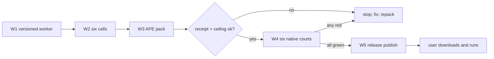

# 0.0.1 — first `minicon-harness.com` release

Status: `[v]` shipped 2026-10-27. W1-W5 all green; release run 40476431216
(verify + execute + publish + post-publish court), pack run 40471315325.
Owner: `prd/PRD_01_01_com_delivery.md`.

## Outcome tree DAG

```text
Outcome: a user downloads minicon-harness.com v0.0.1 and runs a bounded task on their OS
├── [v] W1 — versioned worker: --version banner, canonical version literal
│   invariant: one LF-terminated version literal; --version exits 0 with
│   "minicon-harness 0.0.1"; unknown flags still exit nonzero
│   evidence: cargo test green; native --version courts below
│   safe failure: missing banner fails the court, never ships silently
├── [-] W2 — six native cells at the release profile
│   invariant: each cell is a plain static binary of this exact source SHA
│   evidence: per-cell build logs + sha256 in the build receipt
│   safe failure: a missing or non-running cell blocks the aggregate gate
│   dependency: W1; non-goal: recompiling cells on test runners
├── [-] W3 — APE pack: cosmocc trampoline + ZipOS overlay
│   invariant: packed bytes = loader + cells; MINICON_HARNESS_CELLS override
│   for local dispatch; 5 MiB ceiling (PRD 01.01)
│   evidence: build-receipt.json with loader source sha, per-cell digests,
│   packed APE sha256; local run on this Windows host via the win-x86_64 cell
│   safe failure: over-ceiling or receipt mismatch stops the release
│   dependency: W2; non-goal: cosmopolitan libc rebuild of the worker
├── [-] W4 — six native courts on the packed bytes
│   invariant: every runner executes the SAME downloaded APE; checks
│   --version, unknown-flag refusal, file-bound refusal, exec empty-allow-list
│   refusal; hash equality with the pack output
│   evidence: per-cell court logs in the workflow run
│   safe failure: any red cell blocks publish; dependency: W3
└── [-] W5 — public Release v0.0.1
    invariant: tag created only if absent; uploaded bytes are the packed
    bytes, re-hashed; asset executes from the release download
    evidence: public release page with the three assets visible
    safe failure: verification failure aborts before publish; dependency: W4
```

## Memory palace



## Sequence

1. W1 in-repo: add the version banner and `--version`; unit-test it.
2. W2 locally on this Windows host: build win-x86_64 cell now; the other
   five cells build in CI (Linux/macOS runners own their lanes).
3. W3: vendor the loader method (loader.c adapted for this product's env
   var and mark prefix), pack with pinned cosmocc 4.0.2 in CI, emit a build
   receipt, run a local pack probe on Windows through the
   `MINICON_HARNESS_CELLS` override path.
4. W4: `minicon-com.yml`-shaped workflow in this repo: one pack job, six
   execute-only court jobs, one aggregate gate.
5. W5: publish workflow — re-verify, `gh release create v0.0.1 --draft`,
   upload, post-publish download-and-execute, then `--draft=false`.
