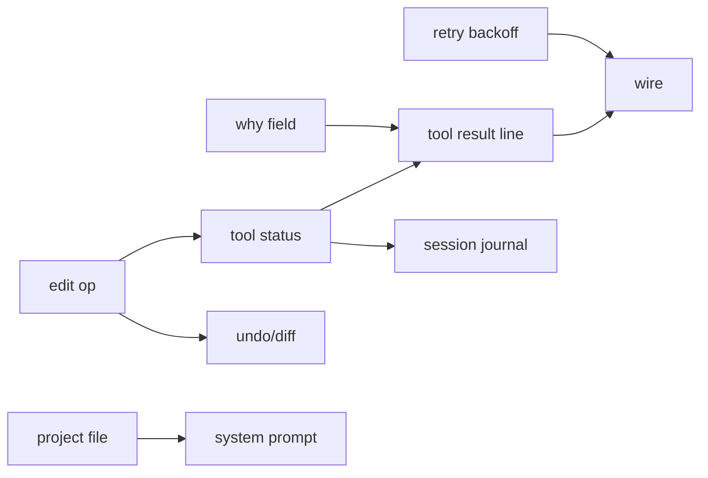

# 0.0.2 — csih-informed capability pass

Status: `[-]` planned 2026-10-30. Source of lessons: unisacc `apps/csih`
(PRD.md + docs/). Owner: `PRD.md` 0.0.2 frontier; delivery method stays in
`prd/PRD_01_01_com_delivery.md`.

## What csih teaches that fits this harness

csih measured 2852 real tool calls and distilled the surface to file/exec
(+mind). The pieces below are the ones this crate can take without growing a
TUI or a permission engine. Everything else in csih (takeover protocol,
managed actor, reload hot-swap, mount-namespace sandbox, mind pages) is
either product direction this crate does not have or a separate owner — not
0.0.2 scope.

## Outcome tree DAG

```text
Outcome: a 0.0.2 invocation edits precisely, explains itself, recovers from
transient API errors, and can be resumed
├── [-] E1 — file edit op (exact-match replace)
│   invariant: 0 hits → fail naming the path; 2+ hits → fail EDIT_NOT_UNIQUE
│   without writing; exactly 1 → replace and write back atomically; result
│   reports bytes-after
│   evidence: unit tests for the three counts + non-UTF8 safety; atomicity
│   reuses the existing sibling+rename publish
│   safe failure: ambiguous edit writes nothing; dependency: E4 status;
│   non-goal: regex or fuzzy replace (csih edit.cx rejects those too)
├── [-] E2 — exec `why` field
│   invariant: exec arguments carry a required one-line `why`; the wire
│   schema requires it; the tool result's first line is `why: <text>` before
│   exit/stdout; missing why → refused (schema-level, not a runtime guess)
│   evidence: wire schema test + dispatch test; dependency: none;
│   non-goal: auto-generating why
├── [-] E3 — structured tool status
│   invariant: dispatch derives success from the tool's own evidence —
│   exec: exit code 0; file write: bytes really written; edit: replaced
│   count == 1; read: valid UTF-8 read. A refusal is status=refused, never
│   success. The loop forwards this status in the tool result line so the
│   model sees machine-readable truth, not prose
│   evidence: status enum unit tests per tool; dependency: none;
│   non-goal: gating answers on status (csih's slice gate is TUI-owned)
├── [-] E4 — API retry with backoff
│   invariant: 429/5xx retried at 2s then 5s, max 2 retries; 401/4xx (other
│   than 429) never retried; retry happens inside one budget turn so the
│   10-minute deadline still bounds the whole invocation
│   evidence: ScriptedTransport tests: 503→503→ok passes, 401 fails
│   immediately, 3 consecutive 5xx exhausts; dependency: none;
│   non-goal: streaming, exponential jitter
├── [_] E5 — session journal + resume
│   invariant: one `<root>/.minicon-harness/journal.jsonl` appended per
│   turn (task, tool calls, final answer); `--resume` replays it as prior
│   context ahead of the new task, bound still per-invocation; journal
│   never contains the API key
│   evidence: round-trip test (run, resume, second run sees prior context);
│   corrupt journal → bounded CLI error, not silent fresh start;
│   dependency: E3; non-goal: csih's owner-lock/takeover protocol, cross-
│   process hot swap
├── [_] E6 — undo + diff
│   invariant: every file write/edit records an undo step (bounded 20,
│   oldest dropped); `--undo` restores the previous state of the last step;
│   `--diff` prints what this invocation changed, one file once
│   evidence: unit tests: overwrite-restore, create-then-undo removes,
│   20-step bound; dependency: E1;
│   non-goal: undoing exec side effects (out of scope, csih agrees)
└── [_] E7 — project file into the system prompt
    invariant: `HARNESS.md` at --root (up to 8KB, codepoint-safe truncation)
    is appended to the system prompt; AGENTS.md is the fallback name; absent
    file → no change to the prompt
    evidence: unit tests: no file, HARNESS.md wins over AGENTS.md, 8KB cap
    on a codepoint boundary; dependency: none;
    non-goal: watching the file mid-run
```

## Memory palace



## Sequence

1. E1+E3 together (edit needs status to be meaningful), then E2.
2. E4 wire retry — independent, any slot.
3. E5 journal — depends on E3 status lines being stable.
4. E6 undo/diff — depends on E1.
5. E7 project file — independent, any slot.
6. Version bump to 0.0.2, full test suite, pack via the existing
   minicon-harness.com.yml lane, release v0.0.2 (archives included).

## Non-goals carried from csih review

- TUI/mind pages/exec-collapse UI: csih's product has a terminal; this crate
  is a bounded batch worker. A TUI would be a different owner.
- Sandbox (mount namespace, secrets masking, PID isolation): needs
  `unshare` and a platform owner; this crate's exec env allow-list stays.
- Takeover/managed-actor/handshake: multi-process session ownership is
  mux/minicon territory, not a batch worker.
- Self-iteration gate (slice suite refusal to answer): belongs to a host
  that owns the source being edited; the harness has no project to guard.
