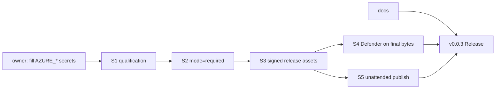

# 0.0.3 — signed releases + defender court

Status: `[-]` planned 2026-10-30. Owner decision this plan implements:
**every future release ships company-signed bytes**. Delivery method stays in
`prd/PRD_01_01_com_delivery.md`; signing mechanics live in
`prd/PRD_01_02_windows_signing.md`.

## Why this version exists

0.0.2 proved the product loop (edit/status/why/retry/journal/undo/project
file) and the delivery loop (APE + per-platform archives + sha256 sidecars).
What it did not prove: the company signature on published bytes, and a
malware-court verdict on those same bytes. 0.0.3 closes both, so the
Windows SmartScreen story and the Defender story stop depending on luck.

## Outcome tree DAG

```text
Outcome: v0.0.3 publishes company-signed Windows bytes, verdict-scanned,
through an unattended release chain
├── [-] S1 — signing qualification on this repository
│   invariant: the owner fills the three release-signing environment
│   secrets (AZURE_CLIENT_ID/TENANT_ID/SUBSCRIPTION_ID); a
│   qualification_only=true run of company-signing.yml then produces
│   Authenticode-Valid bytes with O=PARTNERNET SOFTWARE PTY LTD and an
│   RFC 3161 timestamp, executed on all six native courts
│   evidence: signing-receipt.json with before != after per asset;
│   qualification is never release-eligible
│   dependency: owner action only; non-goal: key export, second identity
├── [-] S2 — flip release-policy signing.mode to required
│   invariant: owner-only flip; after it, release-eligible signing demands
│   an unpublished version and a successful signature; the `off` path keeps
│   working for local dev (pack stays unsigned, courts accept both)
│   evidence: policy diff + one qualification + one release-eligible run;
│   dependency: S1
├── [-] S3 — release.yml consumes the signed chain
│   invariant: when signing.mode == required, the release verifies the
│   signing receipt (schema, publisher, timestamp, before/after hashes,
│   release_eligible=true) and publishes the SIGNED APE plus signed-cell
│   archives; the unsigned bytes never reach a Release asset; when mode ==
│   off the old unsigned path stays (0.0.1/0.0.2 precedent)
│   evidence: one signed v0.0.3 Release where every asset hash matches the
│   signing receipt's after_sha256; dependency: S1, S2
├── [-] S4 — Defender court on final bytes
│   invariant: Microsoft Defender scans the exact published bytes (APE +
│   each Windows archive member) on a fresh windows-2025 runner with
│   current signatures; verdict is clean, or the release blocks; scan
│   failures that are time-window artifacts (Update-MpSignature RPC) get a
│   bounded retry, and the run stays rerunnable on frozen context
│   evidence: defender-court job green on the release run; dependency: S3
│   non-goal: VirusTotal-style multi-engine scanning (one authoritative
│   engine, same as minicon)
├── [-] S5 — release automation repaired end to end
│   invariant: the GITHUB_TOKEN create-release 403 is diagnosed or routed
│   around permanently: either the org policy loosens, or the release job
│   publishes with the owner-scoped PAT stored as a repository secret
│   (values never in logs); the whole chain (pack → candidate → sign →
│   defender → release) runs without a human laptop
│   evidence: v0.0.3 published by CI alone; dependency: S3
│   non-goal: changing the publisher identity
└── [_] S6 — docs court
    invariant: README documents --resume/--undo/--diff, the `why` and
    `status=` wire shape, HARNESS.md, and what a signed release means for
    SmartScreen; the Chinese README mirrors it
    evidence: docs court greps both READMEs for each flag; dependency: none
```

## Memory palace



## Sequence

1. S1 owner action (the only human step): fill three secrets, dispatch
   company-signing.yml with qualification_only=true, read the receipt.
2. S2 policy flip + S3 release.yml signed path, developed together.
3. S4 Defender court, then S5 the unattended publish fix.
4. S6 docs any time.
5. Bump to 0.0.3, full suite, pack, candidate, sign, defender, release.
   Courts read the version from the receipt (no hardcode).

## Non-goals

- Signing anything other than the APE and the two Windows cells (the Unix
  cells have no Authenticode).
- A second publisher identity, key export, or per-product certificate.
- Changing the tool surface: 0.0.3 is delivery hardening, not features.
