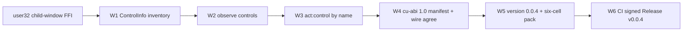

# 0.0.4 — semantic computer use: typed controls + named targets

Status: `[v]` W1-W5 delivered in the tree (2026-11-04); `[_]` W6, the CI signed
Release, is a separate step and is not claimed until the tag has downloadable
assets. Owner direction this plan implements:
**design the CU capability ourselves and build it**; the harness later studies
**omp** for capability shape, but dynamic logic runs on our own **unisa + ujs**
architecture, not bun. This plan does not embed an engine.

## Why this version exists

0.0.4-in-tree delivered a wide pixel surface (`PRD_01_03`) and a versioned
host contract (`PRD_01_04`), but observation was still **windows + pixels**.
A text-only model could list `hwnd=... class=... title=...` and capture a PNG,
yet could not read a single button's name, role or state. The stated gap table
offered only two routes -- hand-write a UIA COM subset (400-600 lines of
unsafe vtable/VARIANT code) or take `minicon-platform` as an optional feature
-- and both break a stated invariant.

**Design decision (ours, not one of the two offered):** take a third route.
Win32 already exposes child windows through plain `user32` FFI:
`EnumChildWindows` + `GetClassNameW` + `WM_GETTEXT` via
`SendMessageTimeoutW` (with `SMTO_ABORTIFHUNG`, so a hung foreign process
cannot stall the harness) + `GetWindowRect` + `IsWindowVisible` /
`IsWindowEnabled`. That yields a **typed, bounded, deterministic control
inventory** with class-derived roles -- no COM, no crate, no new file, no
second permission layer. It is honestly *less* than UIA (no value patterns,
no self-drawn controls), and the PRD says so.

That observation is only useful if an action can consume it. So 0.0.4 adds
`act:control`: resolve a control **by name** from the current generation's
frame, refuse ambiguous or stale matches, and place the pointer at its centre
with a readback that must land inside the control's rectangle. This is the
first CU capability that is *semantic* rather than *coordinate* -- the host
side of the seam a later unisa+ujs module will bind to, without any claim
about an engine ABI (PRD 31's readiness gate stays BLOCKED).

## Outcome tree DAG

```text
Outcome: a text-only model can read UI controls and address one by name,
with the same bounds/readback/generation discipline as pixel operations
├── [_] W1 — typed control inventory
│   invariant: EnumChildWindows over one resolved window; class-derived
│   role, WM_GETTEXT text (200 ms timeout, abort-if-hung), rect, visible,
│   enabled, stable label; bounded at 128 controls / 256 chars per text and
│   **reported** rather than silently clipped; deterministic y,x,hwnd order
│   evidence: `controls[]` in CuFrame JSON and in the model-facing text;
│   zero controls is a named result, never an empty success
│   dependency: none; non-goal: UIA COM, value patterns, third-party widgets
├── [_] W2 — observe asks for controls
│   invariant: `controls=true` scans the foreground window, a string scans
│   one uniquely named window; no `controls` means no scan, so a plain
│   observe costs nothing extra; the source and any truncation are reported
│   evidence: wire schema + capability params + admission tests
│   dependency: W1
├── [_] W3 — act:control, a named target
│   invariant: exact label wins, otherwise a substring must be unique;
│   invisible/disabled controls, a missing frame, a stale generation and a
│   centre outside the virtual desktop are refused by name; press defaults
│   to false (hover, no side effect); readback must be inside the control
│   rect, else `not_performed`
│   evidence: typed refusal matrix + one real-desktop hover at a resolved
│   control centre; dependency: W1, W2
│   non-goal: replaying a control by hwnd, acting on an unobserved window
├── [_] W4 — the contract stays the single source of truth
│   invariant: one new CAPABILITIES row, one CuAction variant, one wire enum
│   value, and a test that the enum agrees; cu-abi stays 1.0 (the calling
│   shape did not change, the manifest is discoverable); ScreenSnapshot is
│   still the typed frame, text is still a rendering of it
│   evidence: `cargo test --offline` on every cell + non-Windows whole-file
│   type-check; dependency: W1..W3
├── [_] W5 — version 0.0.4
│   invariant: Cargo.toml, Cargo.lock, release-policy.json and the APE
│   VERSIONINFO move together; PRD/README stop calling 0.0.4 "not yet
│   published" and record what a bump does and does not promise; the six-cell
│   pack is run once so the new FFI is actually cross-compiled, not merely
│   type-checked locally
│   evidence: consistent version grep + a green minicon-harness.com run;
│   dependency: W4
└── [_] W6 — delivery chain (separate from source)
    invariant: pack → candidate → signing → defender → release is CI's job;
    a source version bump is NOT a published Release. No "released" claim is
    made until `gh release view v0.0.4` shows the tag with downloadable
    signed assets
    evidence: release view + re-hashed download, or an explicit blocker
    dependency: W5, release-signing environment secrets
```

## Memory palace



## Sequence

1. This plan (`plan/plan-0.0.4-cu-semantic-observation.md`) and
   `prd/PRD_01_05_semantic_controls.md` before code.
2. W1 in `src/screen.rs` (native backend + stub + pure helpers), W4's typed
   frame in the same file.
3. W2/W3/W4 in `src/cu.rs` and `src/wire.rs`; the `lib.rs` screen branch stays
   a thin adapter over `CuHost`.
4. Tests: pure helpers on every cell, refusal matrix, a real-desktop journey
   publishing `cu-controls.json`, and an independent Python reader for it.
5. W5: bump the four version files, run the full suite, the two ignored
   journeys, the non-Windows whole-file type-check, then push and dispatch
   the pack workflow.
6. W6: continue the CI chain only as far as it actually goes; report the
   blocker rather than implying a release.

## Non-goals

- `[no]` UIA COM, `minicon-platform`, any new dependency, a second file per
  cell, or a second permission layer.
- `[no]` claiming a UIA accessibility tree: roles are **heuristics derived
  from Win32 class names**. Chromium/Electron-style self-drawn UIs usually
  expose no child windows; the tool reports zero controls and says why.
- `[no]` embedding ujs/WASM/bun/Node, or claiming an engine ABI. PRD 31's
  readiness gate (immutable unisacc/ujs revision inspected and measured) is
  still BLOCKED.
- `[no]` per-OS qualification or an image arm in the wire codec.
- `[no]` silently clipping the control list or guessing an ambiguous target.

## Evidence to be collected

- `cargo test --offline` on Windows (unit) and `cargo test --offline --
  --ignored` (real desktop, three journeys after this plan).
- `cu-controls.json` written by the real-desktop journey, read by an
  **independent** Python script: controls are sorted, labelled uniquely,
  bounded, and the resolved hover pointer lies inside the chosen rect.
- Whole-file type-check of `screen.rs` + `cu.rs` in the non-Windows
  configuration (six cells still refuse by name).
- A green `minicon-harness.com` run on the pushed SHA: first time the screen
  and CU modules are actually cross-compiled into the six native cells.
