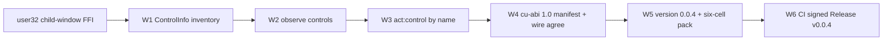

# 0.0.4 — semantic computer use: typed controls + named targets

Status: `[v]` W1-W6 delivered (2026-11-04). W6 closed with public **v0.0.4**:
`gh release list` shows it as Latest, `gh release view v0.0.4` reports
`isDraft:false`, `isPrerelease:false`, `publishedAt 2026-11-04T18:30:16Z`
and 15 downloadable assets; `release.yml` run **41889579027** is green on all
five jobs (verify, execute-linux, publish, defender, post-publish). Owner
direction this plan implements:
**design the CU capability ourselves and build it**; the harness later studies
**omp** for capability shape, but dynamic logic runs on our own **unisa + ujs**
architecture, not bun. This plan does not embed an engine.

## Why this version exists

0.0.4-in-tree delivered a wide pixel surface (`PRD_01_03`) and a versioned
host contract (`PRD_01_04`), but observation was still **windows + pixels**.
A text-only model could list `hwnd=... class=... title=...` and capture a PNG,
yet could not read a single button's name, role or state. The stated gap table
offered only two routes -- hand-write a UIA COM subset (400-600 lines of
unsafe vtable/VARIANT code) or take `minicon-platform` as an optional feature
-- and both break a stated invariant.

**Design decision (ours, not one of the two offered):** take a third route.
Win32 already exposes child windows through plain `user32` FFI:
`EnumChildWindows` + `GetClassNameW` + `WM_GETTEXT` via
`SendMessageTimeoutW` (with `SMTO_ABORTIFHUNG`, so a hung foreign process
cannot stall the harness) + `GetWindowRect` + `IsWindowVisible` /
`IsWindowEnabled`. That yields a **typed, bounded, deterministic control
inventory** with class-derived roles -- no COM, no crate, no new file, no
second permission layer. It is honestly *less* than UIA (no value patterns,
no self-drawn controls), and the PRD says so.

That observation is only useful if an action can consume it. So 0.0.4 adds
`act:control`: resolve a control **by name** from the current generation's
frame, refuse ambiguous or stale matches, and place the pointer at its centre
with a readback that must land inside the control's rectangle. This is the
first CU capability that is *semantic* rather than *coordinate* -- the host
side of the seam a later unisa+ujs module will bind to, without any claim
about an engine ABI (PRD 31's readiness gate stays BLOCKED).

## Outcome tree DAG

```text
Outcome: a text-only model can read UI controls and address one by name,
with the same bounds/readback/generation discipline as pixel operations
├── [v] W1 — typed control inventory
│   invariant: EnumChildWindows over one resolved window; class-derived
│   role, WM_GETTEXT text (200 ms timeout, abort-if-hung), rect, visible,
│   enabled, stable label; bounded at 128 controls / 256 chars per text and
│   **reported** rather than silently clipped; deterministic y,x,hwnd order
│   evidence: `controls[]` in CuFrame JSON and in the model-facing text;
│   zero controls is a named result, never an empty success
│   dependency: none; non-goal: UIA COM, value patterns, third-party widgets
├── [v] W2 — observe asks for controls
│   invariant: `controls=true` scans the foreground window, a string scans
│   one uniquely named window; no `controls` means no scan, so a plain
│   observe costs nothing extra; the source and any truncation are reported
│   evidence: wire schema + capability params + admission tests
│   dependency: W1
├── [v] W3 — act:control, a named target
│   invariant: exact label wins, otherwise a substring must be unique;
│   invisible/disabled controls, a missing frame, a stale generation and a
│   centre outside the virtual desktop are refused by name; press defaults
│   to false (hover, no side effect); readback must be inside the control
│   rect, else `not_performed`
│   evidence: typed refusal matrix + one real-desktop hover at a resolved
│   control centre; dependency: W1, W2
│   non-goal: replaying a control by hwnd, acting on an unobserved window
├── [v] W4 — the contract stays the single source of truth
│   invariant: one new CAPABILITIES row, one CuAction variant, one wire enum
│   value, and a test that the enum agrees; cu-abi stays 1.0 (the calling
│   shape did not change, the manifest is discoverable); ScreenSnapshot is
│   still the typed frame, text is still a rendering of it
│   evidence: `cargo test --offline` on every cell + non-Windows whole-file
│   type-check; dependency: W1..W3
├── [v] W5 — version 0.0.4
│   invariant: Cargo.toml, Cargo.lock, release-policy.json and the APE
│   VERSIONINFO move together; PRD/README stop calling 0.0.4 "not yet
│   published" and record what a bump does and does not promise; the six-cell
│   pack is run once so the new FFI is actually cross-compiled, not merely
│   type-checked locally
│   evidence: consistent version grep + pack run 41798684738 (six unique
│   green cells, aggregate court green) + Candidate run 41800442971 sealed;
│   dependency: W4
└── [v] W6 — delivery chain (separate from source)
    invariant: pack → candidate → signing → defender → release is CI's job;
    a source version bump is NOT a published Release. Every published Windows
    binary is company-signed, not just the APE: the signed cells go into the
    two Windows zips, with rewritten sidecars, and the post-publish court
    re-checks the downloaded assets against the signing receipt's
    `after_sha256`. CI, not a laptop, created the public Release; the 0.0.3
    `GITHUB_TOKEN` 403 came from a deleted `environment: release` gate on the
    publish job, which is restored on main. The Defender court scans with
    `MpCmdRun -Scan -ScanType 3 -File` (not `-Path`, which exits 2 with
    "Invalid command line argument") and both Defender and post-publish now
    resolve `TAG` from `verify` outputs.
    evidence: pack 41875365398, Candidate 41881243482, signing 41881370195
    (attempt 3), release 41889579027 all green; `gh release view v0.0.4`
    public + 15 assets; independent re-download/re-hash of the APE and both
    Windows zip members against the receipt's `after_sha256`
    dependency: W5, release-signing environment secrets
```

## Memory palace



## Sequence

1. This plan (`plan/plan-0.0.4-cu-semantic-observation.md`) and
   `prd/PRD_01_05_semantic_controls.md` before code.
2. W1 in `src/screen.rs` (native backend + stub + pure helpers), W4's typed
   frame in the same file.
3. W2/W3/W4 in `src/cu.rs` and `src/wire.rs`; the `lib.rs` screen branch stays
   a thin adapter over `CuHost`.
4. Tests: pure helpers on every cell, refusal matrix, a real-desktop journey
   publishing `cu-controls.json`, and an independent Python reader for it.
5. W5: bump the four version files, run the full suite, the two ignored
   journeys, the non-Windows whole-file type-check, then push and dispatch
   the pack workflow.
6. W6: run the CI chain to the public Release and verify from the owner's
   point of view (release visible, assets downloaded, hashes re-checked,
   published binary executed). Report a blocker rather than implying a
   release when the chain is not green.

## Non-goals

- `[no]` UIA COM, `minicon-platform`, any new dependency, a second file per
  cell, or a second permission layer.
- `[no]` claiming a UIA accessibility tree: roles are **heuristics derived
  from Win32 class names**. Chromium/Electron-style self-drawn UIs usually
  expose no child windows; the tool reports zero controls and says why.
- `[no]` embedding ujs/WASM/bun/Node, or claiming an engine ABI. PRD 31's
  readiness gate (immutable unisacc/ujs revision inspected and measured) is
  still BLOCKED.
- `[no]` per-OS qualification or an image arm in the wire codec.
- `[no]` silently clipping the control list or guessing an ambiguous target.

## Evidence

- `[v]` `cargo test --offline`: 71 passed, 3 ignored; `cargo test --offline --
  --ignored`: all three real-desktop journeys pass. `cargo build --offline`
  reports no warnings; `git diff --check` clean.
- `[v]` `cu-controls.json` written by the semantic journey and read by an
  **independent** Python script: unique labels, class-derived role,
  centre-inside-rect, `press=false`, `performed`, and a `stale` verdict with
  `as_of != current_generation`. Fixture control `button:OK` at
  `rect=[228,251,90,26]`, hover at `[273,264]`, readback `inside control rect`.
- `[v]` whole-file type-check of `screen.rs` + `cu.rs` in the non-Windows
  configuration (six cells still refuse by name).
- `[v]` `minicon-harness.com` run **41798684738** on `5fd7f19`: six unique
  green native cells plus the aggregate court -- the first time screen and CU
  were actually cross-compiled into the packed APE. Candidate run
  **41800442971** sealed those bytes after one CI fix.
- `[v]` CI fix: `candidate.yml`'s preflight asked `gh` for a nonexistent
  `runAttempt` field and failed closed. Aligned with `company-signing.yml`'s
  `attempt` field (`ba2b6ce`) and re-ran the Candidate successfully.
- `[v]` W6 public Release: `gh release list` shows `minicon-harness 0.0.4
  Latest v0.0.4` (published 2026-11-04T18:30:16Z); `gh release view v0.0.4`
  is non-draft, non-prerelease, with 15 assets. CI created it: pack
  **41875365398** (head `1d49eda`), Candidate **41881243482**, signing
  **41881370195** (attempt 3, eight jobs green), dry-run **41887515390**,
  publish **41887683531**, final all-green court **41889579027**. Re-running
  `release.yml` on the already-public tag logged `Release v0.0.4 already
  exists; skipping create` -- no repack, no resign, no asset overwrite.
- `[v]` W6 pre-work: audited the v0.0.3 Release assets from the owner's point
  of view. Downloaded the published `windows-x86_64.zip`, hashed its member
  and compared it with `signing-receipt.json`: the member matched
  `before_sha256` (unsigned), not `after_sha256`. So 0.0.3 shipped only a
  signed APE in signed form; the two Windows archives were unsigned, contrary
  to `plan-0.0.3` S3. `release.yml` now stages the signed cells into both
  Windows zips, rewrites the sidecars, checks the members against the
  signing receipt and re-checks the downloaded Release assets post-publish.
  End-to-end rehearsal against the real v0.0.3 bytes (stage -> receipt
  verify -> five archive members -> published-asset court) passed on all
  four Python steps. `.github/release-notes.md` no longer says "unsigned".
- `[v]` W6 blocker audit: the 0.0.3 `gh release create` 403
  ("Resource not accessible by integration") came from a deleted
  `environment: release` gate on the publish job (minicon's successful
  `release.yml` has it); the gate is restored on main. No org-policy or PAT
  attribution is needed.
- `[v]` W6 chain restart: pack was re-run at the current main HEAD so
  pack/candidate/signing/release all share one `head_sha`. GitHub Actions was
  under a **major incident with degraded availability** (status page,
  2026-11-04T16:12Z onward): macOS runner allocation stalled, one pack run
  reported inconsistent states and the API returned intermittent EOF. Two
  `signed osx-aarch64` attempts were cancelled by runner-queue timeouts, not
  by signing failures; attempt 3 was green. No org-policy or PAT attribution.
- `[v]` W6 Defender court fix (`1eb379c`): the first publish run
  **41887683531** failed only its Defender job. Logs showed `TAG:` empty
  (`needs: publish` cannot see `needs.verify.outputs.tag`) and MpCmdRun
  exiting 2 with `CmdTool: Invalid command line argument` / usage
  `-Scan [-ScanType #] [-File <path> ...]`. Local A/B on the same Windows
  Defender CLI reproduced `-Path` → exit 2 and `-File` → exit 0, on both a
  file and a directory. `release.yml` now uses `-File`, adds `verify` to the
  `defender` and `post-publish` needs, asserts a non-empty `TAG`, and checks
  the release download's exit code. Run **41889579027** logs
  `TAG: v0.0.4`, three `found no threats` scans (release dir + both expanded
  Windows zips), `Defender court: clean`, `published APE ok: minicon-harness
  0.0.4`, and the post-publish court printing `published signed win-x86_64:
  7ca2ba6d203568d1` / `win-aarch64: f2ddb03eda100678`.
- `[v]` W6 owner-view acceptance (independent of CI): downloaded all 15
  v0.0.4 assets with `gh release download`, re-hashed them locally. The
  signed APE, its sidecar and the receipt's `after_sha256` all agree
  (`7e1c2633a8176b8f`), and both Windows zip members equal the receipt's
  `after_sha256` (`7ca2ba6d203568d1`, `f2ddb03eda100678`) rather than
  `before_sha256`; the zip sidecars match the archives. `ape.exe --version`
  copied from the download prints `minicon-harness 0.0.4`.
