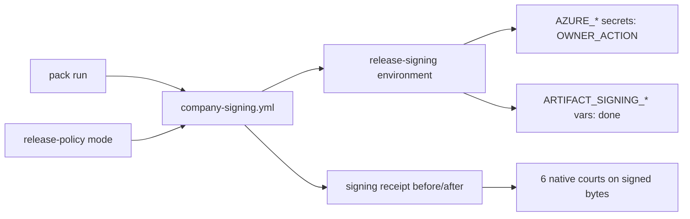

# PRD 01.02 — Windows Authenticode signing

Owner of how minicon-harness.com and the two Windows cells get the company
signature. The method mirrors minicon (see the `sign-windows-artifacts`
skill); this file records only what an operator must do and the current
state.

## Tree DAG

```text
Outcome: published Windows bytes carry the PARTNERNET SOFTWARE PTY LTD
signature with an RFC 3161 timestamp
├── [v] signability: the APE packs a full PE header with the fourteenth data
│   directory reserved (loader/prepare-authenticode.py + authenticode-pad.S)
│   and a VERSIONINFO resource (loader/ape-version.rc); 0.0.1 shipped with
│   the empty directory, so signing never moves headers
├── [v] release-policy.json: signing.mode split, `off` until the owner flips
│   it to `required` (same policy shape as minicon)
├── [v] inspectors: scripts/inspect-authenticode.{ps1,sh} and
│   fetch-microsoft-trust-bundle.sh, byte-identical to
│   pns-authenticode-inspector/v3 (check-product-inspectors OK)
├── [v] company-signing.yml: exact-unsigned-run -> extract two Windows cells
│   from the packed APE (digest-verified) -> Azure Artifact Signing over
│   OIDC -> publisher/timestamp/VERSIONINFO verification -> before/after
│   signing receipt -> six native courts execute the signed bytes. Fails
│   closed while mode=off; qualification_only defaults true
├── [v] candidate.yml: seals one pack run as the Candidate identity
├── [v] signed-cell archives: `release.yml` stages the signed `win-x86_64` /
│   `win-aarch64` cells into the two published Windows zips, rewrites their
│   `.sha256` sidecars, checks the members against the signing receipt's
│   `after_sha256`/`after_bytes`, and re-checks the downloaded Release assets
│   in the post-publish court. Before 0.0.4 this was a **gap**: 0.0.3 published
│   zips containing the *unsigned* cells (member digest ==
│   receipt `before_sha256`), so only the APE was signed. Verified by
│   downloading the v0.0.3 assets and hashing the zip member.
├── [v] readiness: check-product-signing-readiness.sh reports READY
│   (qualification) at main f267658
├── [v] GitHub side: release-signing environment exists;
│   ARTIFACT_SIGNING_{ENDPOINT,ACCOUNT,PROFILE} environment variables are
│   set (endpoint <ENDPOINT>, account <ACCOUNT>, profile <PROFILE>;
│   values live in the release-signing Environment variables)
└── [-] OWNER_ACTION: create the per-repo Entra app via the portal
    click-path in `prd/PRD_01_02_owner_runbook.md` (App registration ->
    federated credential subject
    repo:<ORG>@<ORG_ID>/minicon-harness@<REPO_ID>:environment:release-signing
    (exact numeric subject is computed on demand with gh api, never stored)
    -> Certificate Profile Signer at the minicon-public profile scope),
    then send back Application (client) ID / Directory (tenant) ID /
    Subscription ID; the worker writes the three environment secrets and
    runs both checkers. Rule upheld: one least-privilege principal per
    repository, no copying another product's AZURE_CLIENT_ID
```

## Memory palace



## Non-goals

- macOS signing: different provider, different skill
  (`sign-macos-artifacts`); this harness publishes no macOS-signed artifact
  today.
- A second publisher identity or key export: never.
