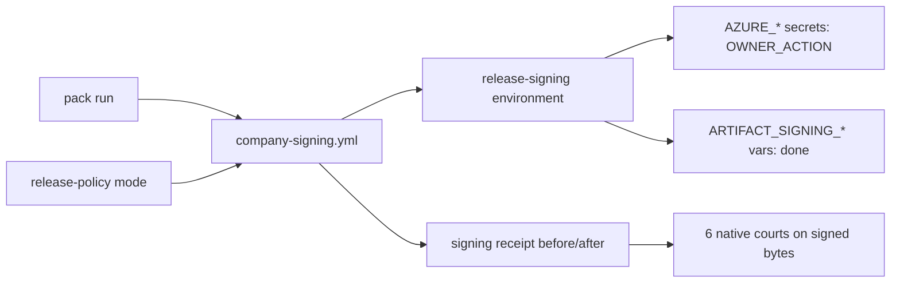

# PRD 01.02 — Windows Authenticode signing

Owner of how minicon-harness.com and the two Windows cells get the company
signature. The method mirrors minicon (see the `sign-windows-artifacts`
skill); this file records only what an operator must do and the current
state.

## Tree DAG

```text
Outcome: published Windows bytes carry the PARTNERNET SOFTWARE PTY LTD
signature with an RFC 3161 timestamp
├── [v] signability: the APE packs a full PE header with the fourteenth data
│   directory reserved (loader/prepare-authenticode.py + authenticode-pad.S)
│   and a VERSIONINFO resource (loader/ape-version.rc); 0.0.1 shipped with
│   the empty directory, so signing never moves headers
├── [v] release-policy.json: signing.mode split, `off` until the owner flips
│   it to `required` (same policy shape as minicon)
├── [v] inspectors: scripts/inspect-authenticode.{ps1,sh} and
│   fetch-microsoft-trust-bundle.sh, byte-identical to
│   pns-authenticode-inspector/v3 (check-product-inspectors OK)
├── [v] company-signing.yml: exact-unsigned-run -> extract two Windows cells
│   from the packed APE (digest-verified) -> Azure Artifact Signing over
│   OIDC -> publisher/timestamp/VERSIONINFO verification -> before/after
│   signing receipt -> six native courts execute the signed bytes. Fails
│   closed while mode=off; qualification_only defaults true
├── [v] candidate.yml: seals one pack run as the Candidate identity
├── [v] readiness: check-product-signing-readiness.sh reports READY
│   (qualification) at main f267658
├── [v] GitHub side: release-signing environment exists;
│   ARTIFACT_SIGNING_{ENDPOINT,ACCOUNT,PROFILE} environment variables are
│   set (endpoint https://eus.codesigning.azure.net/, account
│   partnernetsigning, profile minicon-public)
└── [-] OWNER_ACTION: the three environment secrets
    AZURE_CLIENT_ID / AZURE_TENANT_ID / AZURE_SUBSCRIPTION_ID must hold the
    Entra app values this repository's OIDC identity federates to. Secret
    values are unreadable through the API, and the skill recommends one
    least-privilege principal per repository: either copy the values from
    minicon's environment page, or follow
    sign-windows-artifacts/references/azure-artifact-signing-setup.md to
    create a new app scoped to this repo, then also grant it Certificate
    Profile Signer at the minicon-public profile scope
    (`check-azure-signing-state.sh` verifies RBAC once done)
```

## Memory palace



## Non-goals

- macOS signing: different provider, different skill
  (`sign-macos-artifacts`); this harness publishes no macOS-signed artifact
  today.
- A second publisher identity or key export: never.
